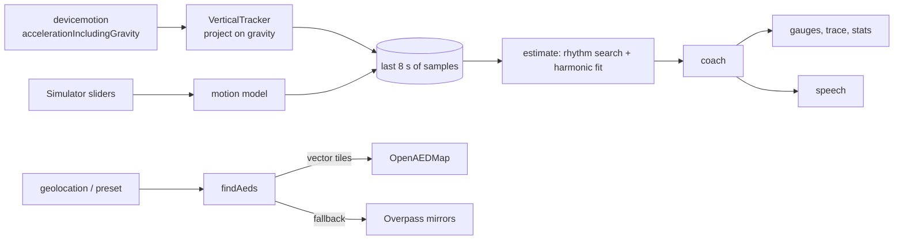

# Design: Lazarus

## Overview

## Estimator (`src/cpr.ts`)
1. Window: last 3 s; needs ≥ 2 s and ≥ 40 samples.
2. Remove mean and linear trend.
3. Coarse search 0.75–3.0 Hz in 0.01 Hz steps, scoring each f by the summed periodogram power at f, 2f, 3f.
4. Disambiguate: for f × {1, 2, 3, ½, ⅓, 1.5, ⅔}, refine ±0.02 Hz by full-fit R². Keep the highest frequency whose R² is within 0.02 of the best. Final refine ±0.003 Hz.
5. Least-squares fit `c + d·t + Σₖ₌₁⁴ (aₖ cos kωt + bₖ sin kωt)`.
6. Displacement `x(t) = −Σ (aₖ cos kωt + bₖ sin kωt) / (kω)²`; depth = peak-to-peak × 100.
7. Quality = R².

`VerticalTracker` low-passes `accelerationIncludingGravity` (τ = 1 s) to estimate gravity and returns `a·ĝ − |g|`.

## Coach
Relative error per dimension (`(100 − rate)/100`, `(rate − 120)/120`, `(5 − d)/5`, `(d − 6)/6`); speak about the larger one. Quality < 0.5 or depth < 1 cm means "start".

## AED search (`src/aed.ts`, `src/mvt.ts`)
- OpenAEDMap tiles at z16 covering the 1.5 km circle's bounding box (z15 if more than 36 tiles), decoded with a minimal MVT reader. Points outside the circle are dropped; clusters are shown as "N defibrillators close together".
- Details for the 12 nearest from `/api/v1/node/{id}`.
- Fallback: Overpass `nwr["emergency"="defibrillator"](around:…)` on three public servers.

## Correctness properties

| # | Property | Requirement |
| --- | --- | --- |
| P1 | For any realistic motion and sensor, rate within 2/min and depth within 0.4 cm, quality > 0.5 | 2.4, 2.6 |
| P2 | Random jostling never yields quality ≥ 0.5 | 2.7 |
| P3 | Less than 2 s of data yields no estimate | 2.4 |
| P4 | Depth is the same (within 0.5 cm) for any phone orientation and either sign convention | 2.5 |
| P5 | Coach zones match the AHA thresholds; "good" only when both are good; focus is never on a dimension that's on target | 3.1–3.3 |
| P6 | No rhythm, or low quality, means "start" | 2.7 |
| P7 | The MVT decoder reads a real OpenAEDMap tile (3 points, node id, tags, position within 10 m) | 5.1 |
| P8 | Every point is inside the tile `lonLatToTile` returns | 5.1 |
| P9 | `tilesAround` covers every point in the search circle | 5.1 |

## Session loop
- Sensor or simulator pushes samples into a ref (trimmed to 8 s).
- A 125 ms interval runs `estimate` → `coach`, accumulates compressions (`rate/60 × dt`) and time on target, and triggers speech.
- Metronome: Web Audio lookahead scheduler, two thumps per beat.
- Wake Lock while the session is open.
